<p align="center">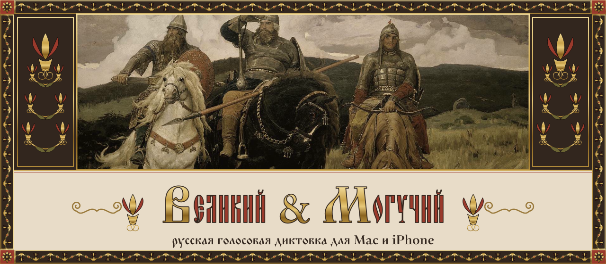<br>
<sub><i>В. М. Васнецов. «Богатыри» (1881–1898), фрагмент. Общественное достояние, Wikimedia Commons. Рамка, вязь и орнамент — свои.</i></sub></p>

<p align="center">
  <a href="https://github.com/zigansh1n/velikiy-moguchiy/releases/latest"></a>
  <a href="https://github.com/zigansh1n/velikiy-moguchiy/actions/workflows/tests.yml"></a>
  <a href="https://github.com/zigansh1n/velikiy-moguchiy/actions/workflows/licenses.yml"></a>
  <a href="https://github.com/zigansh1n/velikiy-moguchiy/actions/workflows/release.yml"></a>
  <a href="LICENSE"></a>
  <a href="CONTRIBUTING.md"></a>
</p>

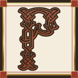усский голосовой ввод для Mac и iPhone: говорите — и текст появляется там, где стоит курсор.
Распознаёт, расставляет знаки, при желании правит текст языковой моделью и вставляет его в любое приложение.
<br clear="left">

> «Во дни сомнений, во дни тягостных раздумий о судьбах моей родины, — ты один мне поддержка и опора,
> о великий, могучий, правдивый и свободный русский язык!» — И. С. Тургенев

**Зачем ещё одна диктовка**

- **Не только голос.** Диктовать можно беззвучно, одними губами: в тишине, в шуме, когда говорить вслух нельзя.
  Диктовка и чтение по губам в одном приложении — среди открытых проектов такого больше нет.
- **Русский в первую очередь.** Пунктуация, IT-термины и англицизмы без искажений, своя русская модель чтения по губам,
  которую обучает сообщество.
- **Удобство.** Проект начался как диктовка, которой приятно пользоваться каждый день, и вырос из неё.
- **Название** — отсылка к тургеневскому «великий и могучий русский язык».

<p align="center"></p>

<h2 align="center">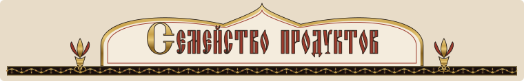</h2>

<p align="center">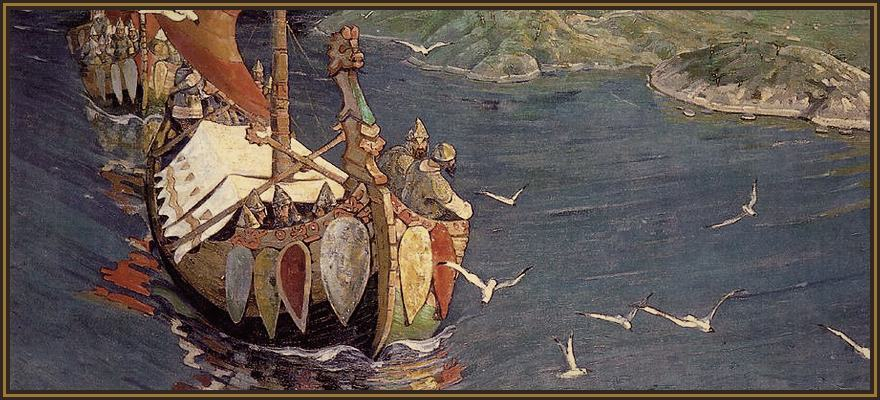<br>
<sub><i>Н. К. Рерих. «Заморские гости» (1901). Общественное достояние, Wikimedia Commons.</i></sub></p>

дин репозиторий, четыре части. У каждой своя папка и свой README с установкой и сборкой.
<br clear="left">

| Продукт | Папка | Что делает | Состояние |
|---|---|---|---|
| **Диктовка для macOS** | [`mac/`](mac/) | Приложение в строке меню: нажали клавишу, говорите, отпустили — распознанный и при желании исправленный LLM текст вставляется в любое приложение. | работает; сборка без подписи Apple |
| **Клавиатура для iPhone** | [`ios/`](ios/) | Клавиатуры RU и EN, повторяющие системную клавиатуру iOS 26, с кнопкой нейродиктовки (Qwen Omni). | работает; IPA без подписи |
| **Чтение по губам** | [`lipread/`](lipread/) | Беззвучная диктовка по видео с камеры на модели MultiVSR, дообученной на русском; на Mac — экспериментальный режим «губы». | **эксперимент**, ошибка ~70% слов |
| **Обучение силами сообщества** | [`federated/`](federated/) | Федеративное дообучение адаптера: учится на устройстве, на сервер уходят только изменения весов, и только с отдельного согласия. | каркас; сервера общего обучения пока нет |

<p align="center"></p>

<h2 align="center">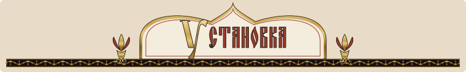</h2>

**Готовые сборки** — на странице [Releases](https://github.com/zigansh1n/velikiy-moguchiy/releases):
`VelikiyMoguchiy-macOS-arm64.zip` (Mac на Apple Silicon, macOS 14+) и `VelikiyMoguchiy-iOS-unsigned.ipa`
(iPhone с iOS 26). Подписи Apple у них пока нет: как открыть приложение на Mac и как поставить IPA на iPhone,
написано в [`mac/README.md`](mac/README.md) и [`ios/README.md`](ios/README.md).

**Из исходников:**

```bash
git clone https://github.com/zigansh1n/velikiy-moguchiy.git
cd velikiy-moguchiy
```

| Продукт | Коротко | Подробно |
|---|---|---|
| macOS | `cd mac && make build && make install-app` (Xcode, Rust, cmake, XcodeGen) | [`mac/README.md`](mac/README.md) |
| iPhone | `cd ios && cp Config/Secrets.xcconfig.example Config/Secrets.xcconfig && xcodegen generate` (Xcode 26) | [`ios/README.md`](ios/README.md) |
| Чтение по губам | `cd lipread && ./setup.sh && ./download_weights.sh` (Apple Silicon, uv, ffmpeg) | [`lipread/README.md`](lipread/README.md) |
| Общее обучение | `cd federated && .venv/bin/python -m pytest` | [`federated/README.md`](federated/README.md) |

Ключ провайдера распознавания (для русского — DashScope, модели Qwen) вы указываете сами в настройках
приложения; в репозитории и в сборках ключей нет.

<p align="center"></p>

<h2 align="center">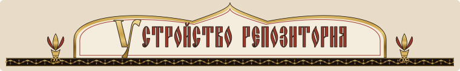</h2>

| Путь | Что там |
|---|---|
| `mac/` | приложение macOS: оболочка на Objective-C, ядро на Rust (`velikiy-moguchiy-core`, `-asr`, `-cli`), Swift-пакеты |
| `ios/` | приложение и клавиатуры iOS (XcodeGen `project.yml`), тесты, проверка совпадения с клавиатурой Apple |
| `lipread/` | чтение по губам: запись, оценка, дообучение LoRA, сервис для режима «губы» |
| `federated/` | протокол, сервер, клиент и симуляция федеративного обучения |
| `tools/` | служебные инструменты: охранник памяти, статус конвейера, проверки приватности и текстов |
| `.github/` | `tests.yml` — тесты на каждый PR; `build-apple.yml` — сборка Mac и iOS (по метке `build`, тегу или вручную); `release.yml` — черновик релиза по тегу `v*`; `privacy.yml` и `text-review.yml` — проверка приватности и текстов в каждом PR; `stores.yml` — Homebrew и AltStore после релиза; `labels.yml` — ярлыки; `contributors.yml` — таблица участников; шаблоны issue и PR |

<p align="center"></p>

<h2 align="center">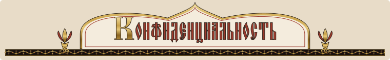</h2>

Полный текст: [`PRIVACY.md`](PRIVACY.md), условия: [`TERMS.md`](TERMS.md).

- Учётной записи нет, своей аналитики приложения не отправляют.
- Речь уходит только провайдеру распознавания, **ключ которого вы указали сами**; с локальными моделями — никуда.
- История, записи и видео хранятся только на вашем устройстве.
- **Камера и участие в общем обучении — два отдельных согласия, оба по умолчанию выключены.** Изображение лица —
  биометрические данные (152-ФЗ).
- Сервера общего обучения пока нет. Когда он появится, при участии в обучении будут отправляться только
  **изменения весов адаптера**, никогда не видео, звук или текст.

<p align="center"></p>

<h2 align="center">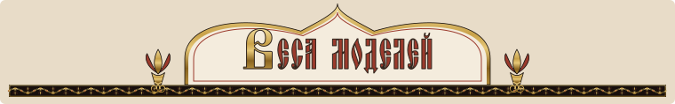</h2>

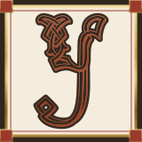 У MultiVSR лицензия не указана: в репозитории авторов нет файла лицензии, условий использования они не называют
и просят только ссылаться на статью. Поэтому **его код и исходные веса в этом репозитории не лежат и проектом не
распространяются**: `lipread/setup.sh` берёт код у авторов, `lipread/download_weights.sh` скачивает веса у авторов на
вашу машину. Дообученная модель проекта lips-0.1 (надстройка LoRA и дообученная визуальная часть) — производная от
MultiVSR; она опубликована по решению автора проекта на Hugging Face
([z1gansh1n/velikiy-moguchiy-lips](https://huggingface.co/z1gansh1n/velikiy-moguchiy-lips)), пока её не заменит своя
модель, обученная с нуля, и будет убрана, если авторы MultiVSR возразят. Исходных весов MultiVSR в ней нет.
Остальные модели, данные и их лицензии — в [`THIRD_PARTY.md`](THIRD_PARTY.md).
<br clear="left">

<p align="center"></p>

<h2 align="center">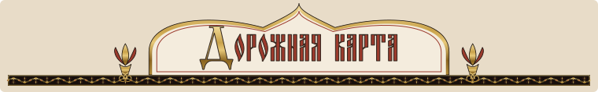</h2>

<p align="center"><br>
<sub><i>Н. К. Рерих. «Гонец. Восстал род на род» (1897). Общественное достояние, Wikimedia Commons.</i></sub></p>

1. **Чтение по губам:** больше данных и обучение, пока ошибка заметно падает; затем «звук + губы» в шуме.
2. **Своя модель губ без весов MultiVSR** — чтобы веса можно было распространять свободно.
3. **Общее обучение:** приём обновлений на Cloudflare Worker, объединение в GitHub Actions, модель на Hugging Face;
   в приложении — только с отдельного согласия. Сейчас в работе.
4. **Приложение для Windows и клавиатура для Android** — в работе.
5. **Подписанная сборка для macOS** (нотаризация, автообновление) и **TestFlight / App Store** для клавиатуры.

Состояние чтения по губам и замеры — в [`lipread/README.md`](lipread/README.md).

<p align="center"></p>

<h2 align="center">Начало и автор</h2>

«Великий & Могучий» задуман и начат одним человеком — [**zigansh1n**](https://github.com/zigansh1n). Замысел,
первые версии диктовки, клавиатуры и чтения по губам, сбор данных, обучение моделей и все расходы на них — его труд.

Но с первого дня это не личный проект, а общий. Автор искренне верит: русское сообщество — самое сплочённое,
смекалистое и сильное на свете. Когда русские люди берутся за общее дело, они доводят его до конца и делают лучше,
чем любая корпорация. Поэтому здесь всё открыто — код, путь, цифры, ошибки и расходы.

Берите, улучшайте, расширяйте. Каждому, кто добавит строку кода, час данных или шаг обучения, — низкий поклон и место
в таблице вклада. Вместе научим машины понимать великий и могучий русский язык.

<p align="center"></p>

<h2 align="center">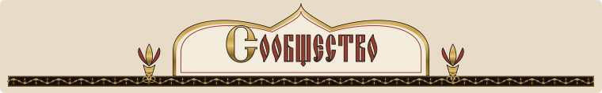</h2>

<p align="center">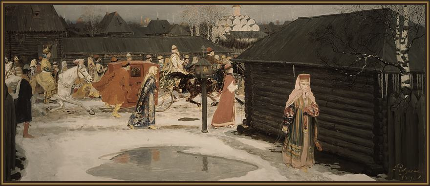<br>
<sub><i>А. П. Рябушкин. «Свадебный поезд в Москве (XVII столетие)» (1901). Общественное достояние, Wikimedia Commons.</i></sub></p>

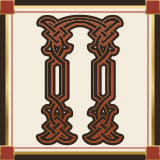омочь можно кодом, часами своих данных для чтения по губам (только с согласием, видео не покидает ваш компьютер)
и шагами обучения общей модели. Как собрать, проверить и прислать изменения — в [`CONTRIBUTING.md`](CONTRIBUTING.md);
как мы общаемся — [`CODE_OF_CONDUCT.md`](CODE_OF_CONDUCT.md); ошибки и идеи —
[issues](https://github.com/zigansh1n/velikiy-moguchiy/issues/new/choose).
<br clear="left">

Таблицу ниже собирает автоматика из [`contributors.json`](contributors.json) (`.github/workflows/contributors.yml`);
вручную её не правьте.

<!-- contributors:start -->
| Участник | Часы данных | Шаги обучения | Принятые обновления весов |
|---|---:|---:|---:|
| [zigansh1n](https://github.com/zigansh1n) | 439 | 6 572 | 2 |
<!-- contributors:end -->

<p align="center"></p>

<h2 align="center">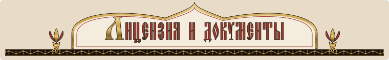</h2>

- Код — [MIT](LICENSE); уведомления об авторских правах на заимствованный код — в `mac/LICENSE`
  и [`THIRD_PARTY.md`](THIRD_PARTY.md).
  Клавиатура iPhone основана на GeminiKeyboardSample и распространяется по Apache-2.0 (`ios/LICENSE`).
- [`NOTICE`](NOTICE) — атрибуции; [`THIRD_PARTY.md`](THIRD_PARTY.md) — сторонние компоненты, модели, данные.
- [`PRIVACY.md`](PRIVACY.md) — политика конфиденциальности; [`TERMS.md`](TERMS.md) — условия использования.
- Оформление: картины из общественного достояния (Васнецов, Рерих, Рябушкин, Билибин; список с источниками —
  в [`THIRD_PARTY.md`](THIRD_PARTY.md)), рамки, орнамент и значки нарисованы для проекта
  ([`design/old-rus/`](design/old-rus/)); шрифты Oglavie, Monomakh, Vertograd (набор fonts-cu) и Old Standard TT — SIL OFL 1.1.

<p align="center">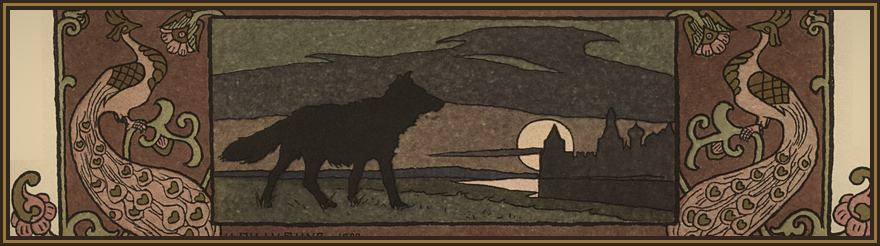<br>
<sub><i>И. Я. Билибин. Заставка к «Сказке об Иване-царевиче, Жар-птице и о Сером волке» (1899). Общественное достояние, Wikimedia Commons.</i></sub></p>

<p align="center">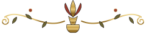</p>
