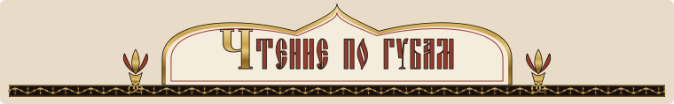

<p align="center"></p>

# «Великий & Могучий»: чтение по губам (lipread)

**Экспериментальная часть.** Беззвучная диктовка по видео с камеры: модель MultiVSR, дообученная на русском, на Mac
с Apple Silicon. Ошибка пока около 70% слов, это демонстрация, а не замена голосовой диктовке. Веса MultiVSR
скачиваются у авторов, в репозитории их нет. Обзор проекта — в [корневом README](../README.md).

Шаг 1 эксперимента: проверить, насколько хорошо готовая модель **MultiVSR** (Oxford VGG, ICASSP 2025,
[репозиторий](https://github.com/Sindhu-Hegde/multivsr)) читает по губам **по-русски** на ваших собственных
записях с веб-камеры. Модель смотрит только на видео, звука нет, на выходе предложение.

Что здесь есть:

1. MultiVSR, запускаемый на Apple Silicon (`mps`, иначе `cpu`) вместо CUDA;
2. рекордер: показывает фразу, вы беззвучно её проговариваете, сохраняется клип и текст;
3. оценка: предобработка клипов как у авторов, распознавание, WER и CER, задержка, таблица в `results/baseline.md`.

Веса MultiVSR в репозиторий не входят и скачиваются отдельно: около 4,5 ГБ (модель 3,37 ГБ + VTP-извлекатель
признаков 1,08 ГБ), команда ниже.

## Требования

- Mac на Apple Silicon (проверено на M3 Max, 36 ГБ), macOS;
- `uv` (`brew install uv`) и `ffmpeg` (`brew install ffmpeg`);
- веб-камера (встроенная FaceTime HD подойдёт).

## Установка

```bash
cd velikiy-moguchiy/lipread         # из корня клона репозитория
./setup.sh
```

`setup.sh` клонирует MultiVSR у авторов на закреплённом коммите `af28d8c`, правит эту локальную копию под
Apple Silicon скриптом `multivsr_compat.py` и создаёт окружение `uv sync` (Python 3.13, torch 2.7.1). Кода
MultiVSR в этом репозитории нет: у него не указана лицензия, поэтому правки делаются у вас на машине, только в тех
файлах, которым они ещё нужны, и сверяются по SHA-256 (результат байт в байт тот же, на котором шли обучение и
оценка). Проверить состояние копии: `python3 multivsr_compat.py --check`.

Проверка, что всё запускается:

```bash
uv run record.py --help
uv run evaluate.py --help
uv run python metrics.py            # самопроверка WER/CER
uv run python tests/test_record_flow.py   # логика рекордера без камеры
```

## Веса модели

```bash
./download_weights.sh
```

| Файл | Размер | Откуда |
|---|---|---|
| `weights/model.pth` (lip-reading transformer) | 3 374 308 500 байт (3,37 ГБ) | https://www.robots.ox.ac.uk/~vgg/research/multivsr/model.pth |
| `weights/feature_extractor.pth` (VTP) | 1 079 529 003 байт (1,08 ГБ) | https://www.robots.ox.ac.uk/~vgg/research/vtp-for-lip-reading/checkpoints/extended_train_data/feature_extractor.pth |
| **Итого** | **4 453 837 503 байт, 4,45 ГБ (4,15 ГиБ)** | |

Скрипт докачивает при обрыве и сверяет размер. Папка `weights/` не коммитится.

## Запись 50 фраз

```bash
uv run record.py
```

Откроется окно с камерой, фраза показана крупно в верхней части (рядом с объективом). Клавиши:

| Клавиша | Действие |
|---|---|
| Пробел | начать запись; ещё раз Пробел: закончить, клип сохраняется, показывается следующая фраза |
| R | во время записи: отбросить дубль; в ожидании: вернуться к предыдущей фразе и перезаписать её |
| N | пропустить фразу |
| F | полный экран |
| Esc или Q | выход (повторный запуск продолжит с первой незаписанной фразы) |

Результат: `clips/001.mp4` (камера, 1280x720, ровные 25 fps, без звука) и `clips/001.txt` (эталонный текст), и так далее до `050`.

**Разрешение на камеру.** При первом запуске macOS спросит доступ к камере для приложения, из которого вы запустили
скрипт (Terminal, iTerm, VS Code и т. п.). Нажмите «Разрешить». Если отказали или вопрос не появился:
System Settings, Privacy & Security, Camera, включите это приложение и запустите снова.
Из неинтерактивной оболочки камера не откроется, пока доступ не выдан, это нормально.
Быстрая проверка без окна: `uv run record.py --check` (запишет секунду в `work/camera_check.mp4`).
Если у вас Continuity Camera (iPhone), рекордер сам выбирает встроенную камеру; `--camera <номер|часть названия>`
и `--list-cameras` позволяют выбрать другую.

Советы по съёмке (качество зависит от этого сильнее, чем кажется):

- лицо целиком, анфас, на уровне камеры, ровный фронтальный свет, без контражура, фон неважен;
- лицо должно занимать заметную часть кадра (но не обрезаться), сидите на привычном расстоянии;
- после Пробела выждите около 0,5 с с закрытым ртом, проговорите фразу **артикулируя, как обычно, но без звука**,
  затем снова паузу около 0,5 с и Пробел;
- не отворачивайтесь, не закрывайте рот рукой, не жуйте;
- всю серию снимайте в одной позе и при одном свете. Для первого замера этого достаточно.

Клипы (`clips/`) содержат ваше лицо и не попадают в git (`.gitignore`).

## Оценка

```bash
uv run evaluate.py
```

Для каждого клипа: предобработка (кэш в `work/faces/`), распознавание с `--lang_id ru`, строка «эталон -> гипотеза».
В конце WER, CER, средняя и медианная задержка на клип и таблица в `results/baseline.md`.
Нормализация: нижний регистр, ё=е, пунктуация убрана. Отдельной строкой даётся «мягкий» вариант
(цифры -> слова, `GitHub` -> `гитхаб` и т. п., см. `metrics.py`), потому что модель обучена на разметке Whisper и
может писать «гитхаб» там, где в эталоне `GitHub`.
Полезные ключи: `--device cpu|mps`, `--limit N`, `--force-preprocess`, `--beam 20`, `--lang auto`.

Без весов можно проверить весь конвейер на случайных весах: `uv run evaluate.py --random-weights --max-decode-len 30`
(результат бессмысленный, отчёт пишется в `results/dryrun.md`).

## Файлы

| Файл | Что делает |
|---|---|
| `phrases_ru.txt` | 50 бытовых фраз для диктовки, 5-12 слов: рабочие сообщения, числа, GitHub/Telegram/Zoom/Jira/Slack/WhatsApp, имена, вопросы |
| `record.py` | рекордер (OpenCV + ffmpeg), пишет `clips/NNN.mp4` и `NNN.txt` |
| `preprocess.py` | клип с камеры -> трек лица для MultiVSR, повторяет `multivsr/preprocess/run_pipeline.py` |
| `mvsr.py` | загрузка моделей MultiVSR и распознавание клипа (выбор устройства, замер времени) |
| `evaluate.py` | предобработка всех клипов, распознавание, WER/CER, `results/baseline.md` |
| `metrics.py` | нормализация текста, расстояние Левенштейна, WER/CER (без внешних библиотек) |
| `setup.sh` | клонирует MultiVSR на нужный коммит, применяет патч, `uv sync` |
| `download_weights.sh` | скачивает веса MultiVSR у авторов (4,45 ГБ) |
| `run.sh` | `./run.sh evaluate.py ...`: запуск с `PYTORCH_ENABLE_MPS_FALLBACK=1` |
| `multivsr_compat.py` | вносит наши правки под Apple Silicon в локальную копию MultiVSR (кода MultiVSR в репозитории нет) |
| `multivsr/` | код авторов (не в git, ставится `setup.sh`) |
| `weights/`, `clips/`, `work/` | веса, ваши записи, кэш; не в git |
| `results/` | отчёты |
| `tests/test_record_flow.py` | прогон логики рекордера без камеры (видеофайл вместо камеры, клавиши по расписанию) |
| `tests/test_mps_vs_cpu.py` | на случайных весах MPS и CPU дают одинаковый результат, без fallback |
| `dataset.py`, `train.py`, `lora.py`, `memguard.py`, `guarded.sh`, `nightly.sh`, `phrases_train_ru.txt` | дообучение, см. раздел «Дообучение LoRA» ниже |
| `tests/test_guard.py`, `test_dataset_split.py`, `test_record_batch.py`, `check_phrases.py` | защита от утечки теста, разбиение, порции рекордера, проверка фраз |
| `lips_service.py`, `tests/test_lips_service.py` | локальный сервис для режима «губы» в приложении «Великий & Могучий» и его сквозной тест, см. раздел «Сервис для приложения» |
| `train_on_me.py`, `train_on_me_worker.py`, `personal.py`, `tests/test_train_on_me.py` | кнопка «Обучить на мне» в приложении: личная подстройка на маке, см. раздел «Обучить на мне» |

## Что запускается под капотом (предобработка)

Модель обучена на кропах лица, поэтому клип с камеры обрабатывается так же, как у авторов
(`preprocess.py`, код `run_pipeline.py` / `dataset/preprocess.py`):

1. ffmpeg: AVI 25 fps (`-qscale:v 2 -r 25`), затем кадры JPEG;
2. детектор лица S3FD (масштаб 0,25, порог 0,9), трекинг по IoU, интерполяция рамок, медиана 13 кадров;
3. квадратный кроп вокруг лица с запасом 0,4 (по вертикали от верха рамки лица до центра + 1,8 полуразмера рамки, по горизонтали центр ± 1,4 полуразмера, серое поле 110 за краем кадра), ресайз **224x224**;
4. при распознавании: ресайз до **160x160** (ffmpeg `scale`, как decord), центральный кроп **96x96**, **RGB**, значения 0..1,
   без нормализации по среднему, **25 fps**; нарезка на куски по 14 с, луч 20, язык задаётся первым токеном (`<|ru|>`).

Намеренные отличия: S3FD на CPU (на MPS отдаёт неверные рамки), без детекции смены сцен (клип с камеры это один план),
минимальная длина трека 10 кадров вместо 100 (у авторов фразы короче 4 с отбрасываются), при нескольких лицах берётся самое
длинное, звук не используется.

## Что изменено в коде MultiVSR для Mac

Правки вносит `multivsr_compat.py` в вашу локальную копию (раньше это был файл патча в репозитории):

- `config.py`: `--device` по умолчанию cuda, затем mps, затем cpu (флаг остался); `--fp16` по умолчанию только на cuda;
- `models.py`: все `@autocast('cuda')` (5 мест) заменены на переключаемый `amp`/`set_amp(device, enabled)`;
- `inference.py`: `autocast` по типу устройства, `no_grad` вокруг визуального энкодера, чтение кадров через ffmpeg вместо `decord`
  (у `decord` нет колеса под macOS arm64), `torch.load(weights_only=True)` с откатом на полную распаковку;
- `video_io.py` (новый): чтение кадров через ffmpeg `scale=160:160`, как decord;
- `preprocess/...`: S3FD без `cuda`, путь к весам детектора не зависит от текущей папки, `index_select(out=)` заменён (на MPS падал).

Операций, не поддерживаемых на MPS, в самой модели на случайных весах не нашлось: энкодер, VTP и декодер дают на MPS те же числа,
что и на CPU (расхождение порядка 1e-6), и работают с `PYTORCH_ENABLE_MPS_FALLBACK=0`. Переменная `PYTORCH_ENABLE_MPS_FALLBACK=1`
всё равно выставляется в `run.sh`, `mvsr.py` и `evaluate.py` на случай других версий torch. fp16 на MPS по умолчанию выключен.

## Ограничения и лицензия

- У репозитория MultiVSR **нет файла LICENSE**, на странице проекта лицензия не заявлена; авторы просят только ссылаться
  на статью. Лицензия VTP-чекпойнта тоже не найдена. Поэтому исходные код и веса проект не распространяет: `multivsr/` и
  `weights/` не в git, а наши правки к их коду не хранятся патчем: `multivsr_compat.py` вносит их у вас на машине.
- Дообученная модель lips-0.1 — производная от MultiVSR. Она опубликована по решению автора проекта, пока её не заменит
  своя модель, обученная с нуля, и будет убрана, если авторы MultiVSR возразят. Разрешения авторов на это нет, запрета
  тоже нет.
- MuAViC (экзамен) и модели Lipflow, обученные на LRS3, — только для некоммерческой оценки: в сборки и в данные для
  обучения они не попадают и не распространяются. Синтетические лица (SFHQ) и прочие данные тоже не распространяются;
  в репозитории только код и описания (см. `../THIRD_PARTY.md`).
- Модель обучена на YouTube-роликах с лицом в кадре, средняя длина клипа 7,6 с. Короткие фразы по 2-4 с и вебкамера в офисе
  могут вести себя хуже, чем 39,5% WER из статьи. Это то, что измеряет этот эксперимент.
- Выход модели без пунктуации и в нижнем регистре.
- Декодер у авторов без KV-кэша, поэтому задержка на клип измеряется секундами (около 2 с на клип на MPS).

---

## Дообучение LoRA на своих клипах

Идея: VTP (визуальный извлекатель признаков) заморожен, его признаки считаются один раз на клип и лежат в
`work/features/`. Учатся только адаптеры LoRA (ранг 16 на проекциях q и v всех 36 вниманий энкодера и декодера,
1,77 млн параметров из 278,6 млн) на прямой потере «токен за токеном» с токенизатором Whisper и языковым токеном `ru`.
Исходные веса не меняются; адаптеры хранятся отдельно (`checkpoints/<run>/best.pt`, около 7 МБ).

```
clips/ (50 тест)          data/silent/ (ваши беззвучные)   data/voiced/ (приложение диктовки)   data/public/ (публичные признаки)
        \                          |                              |                                  /
         +------------------ dataset.py: лицо (S3FD) + признаки VTP -> data/manifest.jsonl -----------+
                                                   |
                                  train.py: LoRA, смесь источников, dev-потеря, ранняя остановка
                                                   |
                       evaluate.py --lora ...  ->  results/finetune-<дата>.md (сравнение с baseline)
```

### Все модельные задачи только через охранник памяти

Политика: использовать максимум памяти, но без свопа. Любой процесс с PyTorch/MPS запускается через общий
`../tools/mem_guard.py`, обёртка `./guarded.sh` делает это за вас:

```bash
./guarded.sh train.py --run my1 --resume --max-minutes 240
./guarded.sh dataset.py
./guarded.sh evaluate.py --lora checkpoints/my1/best.pt
```

Охранник ставит бюджет MPS = доступная память минус резерв 6 ГБ (`PYTORCH_MPS_*_WATERMARK_RATIO`), а при росте свопа
более 512 МБ или свободной памяти менее 15% замораживает процесс (SIGSTOP) и продолжает, когда память вернётся.
Поэтому код терпит паузы: `--max-minutes` считается по **активному** времени (`memguard.ActiveClock`), таймаутов по
стенным часам нет. Дополнительно: один процесс с моделью за раз, `torch.mps.empty_cache()` каждые 10 микробатчей и между
клипами, аварийный выход с сохранением при свободной памяти менее 10% (`--min-free`). Без охранника (прямой
`./run.sh ...`) `memguard.py` ставит старые безопасные 0,35/0,25.

### 1. Запись обучающих клипов порциями по 50

540 новых фраз в `phrases_train_ru.txt` (5-12 слов, сообщения, работа, числа, GitHub/Telegram/Zoom и т. п.), с тестовыми
`phrases_ru.txt` не пересекаются ни целыми предложениями, ни общими 4-граммами слов (проверка: `uv run python tests/check_phrases.py`).

```bash
uv run record.py --out data/silent --phrases phrases_train_ru.txt --batch 50
```

После 50 новых клипов за сеанс рекордер показывает «Порция записана» и больше не пишет (Esc: выход). Следующий запуск той же
командой продолжает с первой незаписанной фразы, можно хоть через неделю. Клавиши те же (Пробел, R, N, F, Esc). Рекомендация:
12 порций в разные дни и при разном свете, одну позу внутри порции. Тест записан отдельно (`clips/`), в обучение не идёт никогда.

### 2. Откуда берутся данные

| Папка | Что кладут | source | train/dev |
|---|---|---|---|
| `clips/` | 50 тестовых клипов + `.txt` | silent | **test** (только оценка) |
| `data/silent/` | `NNN.mp4` + `NNN.txt` от `record.py` | silent | 85/15 по хэшу нормализованного текста фразы |
| `data/voiced/` | клипы приложения диктовки (ниже) | voiced | 85/15 по хэшу нормализованного текста |
| `data/public/` | готовые признаки публичного набора (ниже) | public | 97/3 по хэшу YouTube-id ролика (весь ролик в одной части) |

**Приложение диктовки (voiced).** На каждую диктовку со звуком приложение сохраняет в `data/voiced/`:

- `ИМЯ.mp4`: видео с камеры (звук не нужен, лицо крупно, 25 fps желательно, любая длина до ~30 с; обучение берёт до 8 с);
- `ИМЯ.txt`: распознанный текст одной строкой (UTF-8).

Правила записи: `.txt` писать **после** видео (клип считается готовым, когда есть оба файла), недописанные файлы называть с точки
в начале (`.ИМЯ.mp4`, они игнорируются), имена уникальные (например, метка времени). Дубли по содержимому отбрасываются.
Текст ASR может содержать ошибки: это шум в метках, поэтому такие клипы идут с меньшим весом (см. `--mix`).

**Публичные данные (public).** Их кладёт отдельный фетчер (`fetch/`) по метаданным MultiVSR (`sindhuhegde/multivsr`), этот пайплайн
только принимает результат. Требуемый вид, на клип с именем `ИМЯ` (рекомендуется `<youtube_id>__<номер>`):

- `ИМЯ.npy`: признаки VTP, массив `(T, 512)` fp16 или fp32, один вектор на кадр, 25 кадров/с (как `work/features/*.npy`);
- `ИМЯ.txt`: транскрипт Whisper (регистр и пунктуация сохраняются, обучение приводит к нужному виду само);
- `ИМЯ.json`: `{"video_id": "<11-символьный YouTube id>"}`: по нему делится train/dev, чтобы ролик не попал в обе части.
  Без json id берётся из имени до `__`.

Допускается и вариант «фетчер положил уже обрезанное лицо 224x224»: `ИМЯ.mp4` + `.txt` + `.json` (json пишется последним). Тогда
`dataset.py` сам считает по нему признаки в `ИМЯ.npy` (S3FD не нужен); ключ `--delete-public-video` после этого удаляет mp4, остаются
только признаки. Тестовые данные из public исключены по построению (источник другой, пересечение по хэшу и по тексту проверяется).
Объём: 25 ч признаков fp16 это 2,3 ГБ; `train.py` читает public с диска по требованию, в ОЗУ их не держит.

### 3. Манифест и признаки

```bash
./guarded.sh dataset.py          # лицо (S3FD, 3 процесса, nice 10) + признаки VTP; возобновляемо, кэш по хэшу видео
```

Результат: `data/manifest.jsonl` (поля: id, video, text, source, split, плюс hash, frames, feats, face) и таблица
«источник/split/клипов/часов». Клипы без лица пропускаются, причина пишется в `work/dataset_skipped.jsonl` (и кэшируется,
чтобы не искать лицо каждую ночь; повтор: `--retry-skipped`). Тоже пропускаются: пустой текст, дубли, длина более 30 с,
клипы с совпадающим с тестом хэшем или текстом. Для 50 тестовых клипов это 40 с (признаки на MPS).

### 4. Обучение

```bash
./guarded.sh train.py --run my1 --max-minutes 240            # с нуля; --resume продолжает после обрыва
./guarded.sh train.py --run my1 --mix public=0.5,silent=0.3,voiced=0.2
./guarded.sh train.py --run my1 --early-steps 300 --early-mix public=0.8,silent=0.1,voiced=0.1 --mix public=0.2,silent=0.6,voiced=0.2
```

- Смесь: `--mix` задаёт веса выбора источника для каждого клипа батча; веса нормируются по источникам, у которых есть train-данные
  (нет public: работает silent+voiced в нужной пропорции). Учебный план: первые `--early-steps` шагов идут со смесью `--early-mix`
  (например, почти всё public), затем с `--mix`.
- Основное: AdamW lr 1e-4, прогрев 100 шагов, косинус до 10%, микробатч 4 клипа, накопление ×4 (эффективный батч 16),
  аугментации на признаках (обрезка до 3 кадров, маскирование до 10% кадров, шум 2%), `--dtype fp32` (bf16 работает, но выигрыша
  в скорости нет, в смоуке память на 1,6 ГБ меньше). С охранником памяти можно поднять `--batch 8` или `--max-seconds` выше.
- Длительность: `--epochs 20` проходов по личным данным (silent+voiced) либо `--max-steps`; `--max-minutes` останавливает по
  активному времени. Dev-потеря считается каждые 25 шагов по **silent-dev** (целевой домен; если его нет, по voiced, затем public),
  отдельно печатаются остальные dev. Ранняя остановка: 8 оценок подряд без улучшения более чем на 0,002.
- Контрольные точки: `checkpoints/<run>/last.pt` (всё для продолжения), `step-NNNNNN.pt` (каждые 25 шагов, хранятся 2), `best.pt`
  (лучшие по dev, только адаптеры; стартовая точка это исходная модель, поэтому `best.pt` не хуже неё по dev), `summary.json`, `train_log.jsonl`.
- Формат целевого текста `--target-format norm` (нижний регистр, ё=е, без пунктуации и без пробела в начале): выбран замером потери
  исходной модели на 30 клипах (`--probe-format`): NLL на слово 4,1 против 5,0 (с пробелом), 9,6 (регистр) и 13,8 (как есть). Исходная модель
  обучена именно на таком виде. Замер использовал тестовые клипы только для прямого прохода, без обучения.

### 5. Оценка

```bash
./guarded.sh evaluate.py --lora checkpoints/my1/best.pt       # -> results/finetune-<дата>.md
```

На тех же 50 тестовых клипах и с теми же метриками (WER/CER строгие и мягкие, нормализация `metrics.py`). Адаптеры сливаются в базовые
веса (`W += (alpha/r)·B·A`), декодирование как у исходной модели (луч 20). Отчёт: таблица «исходная модель / + LoRA / разность» и
**парный бутстреп по клипам**: интервал изменения WER; интервал, не содержащий 0, значит эффект реален, иначе это шум 50 клипов
(одиночный WER на 50 клипах имеет интервал ±9 п.п.). Ориентиры: WER < 55% есть смысл масштабировать, < 40% можно встраивать
в Lipflow, >= 70% дообучение не помогает. Рядом смотрите CER (для диктовки полезно < 25-30%).

### 6. Ночной цикл

```bash
./nightly.sh                         # вручную перед сном; расписание не ставится
MAX_MINUTES=60 ./nightly.sh          # короче
TRAIN_ARGS="--mix silent=1" ./nightly.sh
```

Делает по очереди (`caffeinate -i`, каждый этап под `mem_guard`, nice 10): `dataset.py` (новые клипы), `train.py --resume --max-minutes 240`
(запуск `nightly-<дата>`, повторный запуск в тот же день продолжает его), `evaluate.py --lora ...best.pt`. Итог: `results/finetune-<дата>.md`,
строка в `results/finetune-history.txt`, лог `logs/nightly-<дата>.log`. Каждую ночь обучение идёт с нуля на всех данных (воспроизводимо);
`--init-lora` позволяет вместо этого стартовать с прошлых адаптеров. Мак должен быть на питании, крышку не закрывать.
Расписание на cron/launchd не ставилось.

### 7. Защита теста от утечки

- `dataset.py` не пускает в train/dev клипы с хэшем содержимого, как у теста, и с нормализованным текстом, как у тестовой фразы.
- `train.py` независимо проверяет всё то же перед загрузкой модели (хэши пересчитываются по файлам, не берутся из манифеста на веру)
  и отказывается работать при любом совпадении; видео из `clips/` в train отклоняется тоже.
- Единственный обход `--smoke-allow-test` работает только если и манифест, и `--ckpt-dir` лежат в `work/smoke/` (дымовой тест).
- Проверка: `./run.sh python tests/test_guard.py`.

### 8. Дымовой тест (что проверено)

Дымовой тест прогоняет 10 тестовых клипов как фальшивый train (манифест и чекпойнты только в `work/smoke/`, потом удаляются):
цикл обучения, чекпойнт/продолжение, смесь public+silent с учебным планом, `evaluate.py --lora`. Его цифры ничего не говорят
о качестве, только о работоспособности.

## Сервис для приложения «Великий & Могучий» (режим «губы»)

`lips_service.py` держит дообученную модель загруженной и читает клипы по запросу приложения. Приложение запускает его
само при первом нажатии клавиши губ (`experimental.lips: true`, `hotkey.lips_key`, секция `lips` в
`~/.velikiy-moguchiy/config.yaml`), лог пишется в `lips_service.log` в той же папке.

Какая модель берётся: та, что поставила кнопка «Обучить на мне» (ниже), иначе папка `results/pod_runs/t1/checkpoints/me1`
(в репозиторий не входит), либо любая папка с `best.pt` и `best_venc.pth`, указанная через `--run`. Опубликованные веса
v0.1 лежат на Hugging Face, [z1gansh1n/velikiy-moguchiy-lips](https://huggingface.co/z1gansh1n/velikiy-moguchiy-lips):
`velikiy-moguchiy-lips-0.1.pt` положите в папку под именем `best.pt`, `velikiy-moguchiy-lips-0.1-venc.pth` — под именем
`best_venc.pth` (контрольные суммы в `SHA256SUMS.txt`). Основные веса MultiVSR всё равно нужны: `./download_weights.sh`.

Вручную:

```bash
.venv/bin/python lips_service.py --port 8766 --idle-sec 600
curl -s 127.0.0.1:8766/health
curl -s -X POST 127.0.0.1:8766/transcribe -d '{"path": "/abs/clip.mp4", "rescore": true}'
.venv/bin/python tests/test_lips_service.py --clips 001,005,013 [--rescore]   # сквозная проверка с моделью
```

- Слушает только `127.0.0.1`. Ответ: `text` (после Qwen, если `rescore`), `raw` (лучшая гипотеза модели), `hyps` (5 лучших),
  `timings`.
- Детектор лица работает на каждом 5-м кадре (`--det-every`), рамки между ними интерполируются: предобработка 1,0-1,8 с вместо
  4,3 с. На 50 тестовых клипах WER 70,7% против 72,0% при каждом кадре (95% ДИ разницы [-7,0; +4,1] п.п., то есть разницы нет).
- Память: чекпойнты читаются через `mmap` (в `model.pth` 2,3 ГБ состояния оптимизатора, которое не нужно), визуальный энкодер
  идёт кусками по 25 кадров, луч считает логиты только последней позиции (`MultiVSR(venc_max_frames=25, last_logits_only=True)`,
  гипотезы и оценки те же, проверено). Лимит MPS 0,15 рабочего набора (4,2 ГБ на 36 ГБ); пиковый след процесса около 5,5 ГБ
  вместо 10 ГБ. Модель не грузится, если доступно меньше `--min-avail-gb` (10 ГБ).
- Выгрузка: процесс сам завершается после `--idle-sec` без запросов, если своп вырос больше чем на 256 МБ с его старта, или
  когда пропал `--parent-pid` (приложение). Выход процесса надёжнее выгрузки внутри него: `empty_cache` не возвращает память драйвера MPS.
- Пока модель грузится (9-11 с), клип уже проходит предобработку; приложение просит загрузку при нажатии клавиши.

## «Обучить на мне»: личная подстройка из приложения для Mac

Настройки приложения → карточка «Личная модель чтения по губам» → «Обучить на мне». Приложение запускает
`train_on_me.py run` фоновым процессом и показывает прогресс, оставшееся время и кнопку «Отменить»; задача живёт и
после закрытия приложения, при следующем открытии настроек карточка снова её подхватывает (`lips_training/status.json`).

- **Данные** — клипы, которые приложение сохраняет при включённом «Снимать камеру во время диктовки» (`lipdata.dir`,
  по умолчанию `~/.velikiy-moguchiy/lipdata/voiced`, у установок до переименования `~/.koe/lipdata/voiced`):
  `<unix-ms>.mp4` + `.txt` + `.json`. Метка — распознанный текст чистого звука (`.txt`, до правки LLM). В обучение
  идут клипы 1–12 с с непустым текстом, не совпадающим с тестовыми фразами (`clips/`, R10); кнопка доступна от
  **100** таких клипов. Кропы лиц делаются как у сервиса губ (`preprocess.py`, детектор на каждом 5-м кадре).
- **Отложенная проверка.** 10% фраз (целыми фразами по нормализованному тексту, порядок по хэшу) в обучение не
  попадают никогда. На них сравнивается ошибка в словах (WER) установленной и новой модели, декодирование как у
  сервиса (луч 20, без Qwen). Новая модель ставится, **только если её WER строго ниже**; иначе остаётся прежняя.
- **Режимы.** Оба стартуют с установленной модели (`best.pt` + `best_venc.pth`).

| Режим | Что учится | Как | Время на M3 Max (оценка) |
|---|---|---|---|
| лёгкий | адаптеры LoRA, признаки VTP заморожены | `train.py --init-lora <установленная> --mix voiced=1`, 20 проходов, но не больше 400 шагов, батч 4×4 | ~7 мин на 100 клипов, ~18 мин на 300, ~40 мин на 1000 (кропы лиц потом из кэша) |
| полный | LoRA + визуальная часть VTP | `train_e2e.py --init <установленная>`, батч 2×8, 100–600 шагов; в первый раз сначала 30-шаговый проверочный прогон (R4) | ~50 мин на 100 клипов, ~2 ч на 300, до ~3,5 ч на 1000+ |

  Оценки — из `personal.py` (`SEC_*`): шаг `train.py` и кропы измерены (дымовой тест обучения, сервис губ),
  шаг `train_e2e.py` на MPS и декодирование лучом 20 не мерились на маке, это прикидка. Паузы охранника памяти
  удлиняют время.
- **Память и R11.** Сам `train_on_me.py` модель не грузит. Каждый модельный шаг (`train_on_me_worker.py prepare/evaluate`,
  `train.py`, `train_e2e.py`) идёт под `../tools/mem_guard.py`: бюджет MPS не больше min(16 ГБ, 45% памяти), резерв
  min(8 ГБ, 20% памяти), пауза (SIGSTOP), если свободной памяти меньше 15% или своп растёт (продолжение с 25%),
  nice 10, `caffeinate -i`. На маке меньше чем с 16 ГБ кнопка не включается. На маке модельные
  скрипты работают только с `VELIKIY_MOGUCHIY_APP_JOB=train-on-me`, которую ставит приложение для этой задачи
  (единственное исключение R11 кроме пилота синтетики); всё остальное по-прежнему отказывается работать на маке.
- **Где что лежит** (в папке приложения): `lips_model/active.json` — какая модель стоит и какая была до неё,
  `lips_model/models/<id>/` — `best.pt`, `best_venc.pth`, `model.json` (режим, WER до и после); `lips_training/` —
  `status.json`, `job.log`, кэш кропов и признаков, рабочая папка последнего запуска. Сервис губ читает установленную
  модель сам и перезапускается, когда она меняется.
- **Откат.** Кнопка «Вернуть прежнюю модель» (или `train_on_me.py rollback`) меняет местами текущую и прежнюю модель,
  повторное нажатие возвращает обратно. Вернуться к исходной модели вручную: удалить `lips_model/active.json`.
- **«Поделиться улучшением»** — отдельное согласие, выключено по умолчанию и пока недоступно: сервера для обучения на
  личных записях нет (сервер «Помочь обучить» принимает только обновления по своим заданиям на публичных роликах).
  Уходить будет только изменение весов LoRA, никогда не видео.

```bash
.venv/bin/python train_on_me.py scan                   # что увидит карточка: клипы, минуты, оценки времени, модель
VELIKIY_MOGUCHIY_APP_JOB=train-on-me .venv/bin/python train_on_me.py run --mode light   # то же, что кнопка
.venv/bin/python train_on_me.py status | cancel | rollback
python3 -m pytest tests/test_train_on_me.py            # без весов и без мака: данные, отложенные, установка/откат, охранник
```

